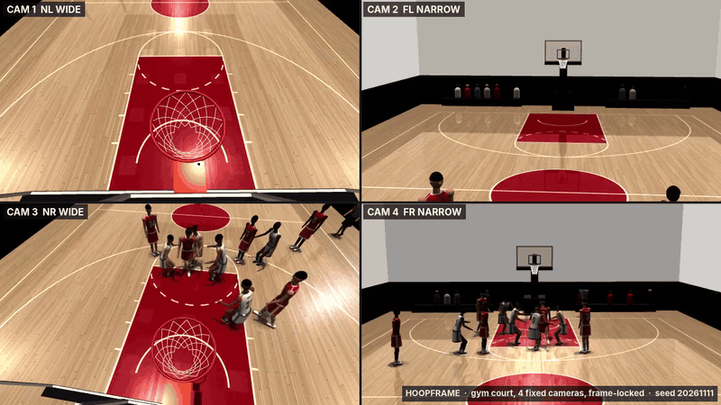

# Hoopframe

Synthetic 5-on-5 full-court basketball with two referees and four configurable cameras. Possession changes ends
after every score and defensive rebound, with transition runs up the floor. It produces ground truth for
multi-view player and referee tracking and shot attribution in two ways:

- **Live feed over MQTT**: ball, player, referee and camera state, plus game events, published every tick.
- **Synchronized recorder**: one MP4 per camera, frame-locked to per-frame ground truth, saved as a ZIP.

[](docs/sample.mp4)

*12 seconds from the built-in recorder on the gym court (`#court-gym&cams-gym`): the gym's four fixed cameras
(NL wide, FL narrow, NR wide, FR narrow), 640 × 360 each, 30 fps, 180° shutter (1/60 s, 4 sub-frames per frame),
seed `20261111`, simulation time 84.5–96.5 s. HAR-3 scores at the +x end; MSA inbounds under that basket, runs
the floor in transition and MSA-0 scores at the −x end, with both referees switching ends.
Click for the [full-quality MP4](docs/sample.mp4).*

Everything is in `index.html`. Open it directly in **Chrome or Edge**: double-click it, or serve the folder with
`python3 -m http.server`. The hosted artifact preview blocks network connections and downloads, so MQTT
and recording only work from this file.

## Live feed (MQTT)

Browsers can only reach MQTT over WebSockets, so the broker needs a WebSocket listener. With Mosquitto:

```conf
# mosquitto.conf
listener 1883
listener 9001
protocol websockets
allow_anonymous true
```

```sh
mosquitto -c mosquitto.conf
```

In the page, open **Data out**, keep `ws://localhost:9001`, and press **Connect**. If the page is served over
HTTPS, the broker must be `wss://`, because browsers block `ws://` from secure pages.

| Topic | QoS | Payload |
| --- | --- | --- |
| `hoopframe/frame` | 0 | Full snapshot for one tick: the same object as a `groundtruth.jsonl` line |
| `hoopframe/ball` | 0 | `pos`, `vel` (null while held), `state` (`held`/`pass`/`free`), `holder`, `pass_to`, `shot_id` |
| `hoopframe/players` | 0 | All ten players |
| `hoopframe/player/<id>` | 0 | One player, e.g. `hoopframe/player/HAR-23` |
| `hoopframe/referees` | 0 | Both referees: `id`, `track`, `role` (`lead`/`trail`), position, velocity, keypoints |
| `hoopframe/camera/<1-4>` | 0 | Calibration `K`, `R`, `t` and, if enabled, 2D `annotations` |
| `hoopframe/events` | 1 | `shot`, `shot_result`, `pass`, `catch`, `rebound`, `inbound`, `recover`, `possession`, `transition_start`, `transition_end`, `tipoff`, `recording_start`, `recording_stop` |
| `hoopframe/recorder` | 1 | Recording start/stop markers with `take` and frame counts |
| `hoopframe/status` | 1, retained | `online`, session, seed, roster, referees. A last-will message flips it to `online: false` |

Every message carries `session`, `frame`, `t` (simulation seconds) and `wall_ms`. While idle, frames are
published on the simulation clock at the chosen rate (`frame = floor(t * rate)`). While recording, they are
published once per captured video frame, and `frame` is the video frame index.

```python
# pip install paho-mqtt
import json, paho.mqtt.client as mqtt

def on_message(client, userdata, msg):
    m = json.loads(msg.payload)
    if msg.topic.endswith("/events") and m["type"] == "shot_result":
        print(m["shot_id"], m["shooter"], m["kind"], m["points"])
    elif msg.topic.endswith("/ball"):
        print(m["frame"], m["pos"], m["holder"])

c = mqtt.Client(mqtt.CallbackAPIVersion.VERSION2)
c.on_message = on_message
c.connect("localhost", 1883)
c.subscribe([("hoopframe/ball", 0), ("hoopframe/events", 1)])
c.loop_forever()
```

## Synchronized recorder

Tick the cameras, then pick the frame rate, bitrate, shutter and maximum length, and press **Start recording**.
Recording is **lockstep**. Each captured frame advances the game by exactly `1/fps` and renders every ticked
camera over that frame's exposure, at that camera's own output size, with the same post-processing as the
program view.
Capture runs as fast as the GPU allows, not in wall-clock time. Each camera's output size is locked while
recording. Position, aim and FOV can still change, and every change is captured in the per-frame calibration.

The ZIP (`hoopframe_<session>_takeNN.zip`) contains:

| File | Contents |
| --- | --- |
| `camN_<name>.mp4` | H.264 (VP9 or AV1 if H.264 is unavailable). Frame `k` has `pts = k / fps` |
| `groundtruth.jsonl` | Line `k` is the snapshot for video frame `k` in every camera |
| `events.jsonl` | Game events. `frame` is the video frame in which the event happened |
| `manifest.json` | fps, frame count, seed, cameras, files, roster, court and coordinate conventions |

Frame rates are divisors of the 240 Hz physics step (24/30/48/60), so `t` advances exactly `1/fps` per frame.

### Shutter and motion blur

The **Shutter** setting gives recordings real motion blur. A frame's exposure lasts `angle / 360 / fps`
seconds. The recorder renders one sub-frame per 1/240 s physics step across that exposure and averages them
in linear light, the way a sensor integrates light. Fast movement (the ball in flight, hands, feet) streaks
along its path, and anything still stays sharp.

| Shutter at 30 fps | Exposure | Sub-frames per frame | Render cost |
| --- | --- | --- | --- |
| Off (0°) | instant | 1 | 1× |
| 90° | 1/120 s | 2 | 2× |
| 180° (default, the film standard) | 1/60 s | 4 | 4× |
| 360° | 1/30 s | 8 | 8× |

Labels describe the **centre** of the exposure, and `t` is that instant. With an even sub-frame count, `t` is
the sample just before the exact centre, which `mean_t` gives (1/480 s later). Each ground-truth line also carries
an `exposure` block with the sample times and the ball's 3D position at every sub-frame. Each camera's ball
annotation adds `path_2d`, the ball's pixel position at every sub-frame, so a model can learn the streak's
extent, not only its centre. The program monitor and the MQTT feed outside recording stay sharp. With
fixed cameras there is no camera-motion blur. A camera that tracks or follows moves during the exposure,
and its blur is included.

### Ground-truth line

```jsonc
{
  "session": "20261111T152320-d7da", "seed": 20261111, "frame": 60, "t": 3.9583,
  "exposure": { "shutter_deg": 180, "duration_s": 0.016667, "samples": 4,
                "start_t": 3.9542, "end_t": 3.9667, "mean_t": 3.9604, "ball_path": [[x, y, z] /* one per sub-frame */] },
  "possession": "HAR", "phase": "play", "attack_dir": 1, "transition": { "from": "defensive_rebound", "t": 1.25, "team": "HAR" },
  "score": { "HAR": 4, "MSA": 2 },
  "ball": { "pos": [x, y, z], "vel": null, "state": "held", "holder": "HAR-23", "pass_to": null, "shot_id": null },
  "players": [{
    "id": "HAR-23", "track": 2, "team": "HAR", "number": 23, "height_m": 2.01,
    "pos": [x, jump_height, z], "vel": [vx, vy, vz], "yaw": 1.57, "speed": 3.1,
    "action": "none", "airborne": false, "has_ball": true,
    "keypoints": { "head_top": [x, y, z], "head": [], "neck": [], "shoulder_l": [] /* … 18 joints */ }
  }],
  "referees": [{ "id": "REF-1", "track": 10, "role": "trail", "height_m": 1.81, "pos": [x, 0, z], "vel": [vx, 0, vz],
                 "yaw": 0.4, "speed": 2.2, "keypoints": { /* same 18 joints */ } }],
  "cameras": [{
    "id": 1, "name": "Broadcast", "width": 1280, "height": 720, "fov_y": 32,
    "K": [[fx, 0, cx], [0, fy, cy], [0, 0, 1]], "R": [[]], "t": [],
    "position": [x, y, z], "quaternion": [x, y, z, w], "follow": null, "track_ball": true,
    "annotations": {
      "players": [{ "id": "HAR-23", "track": 2, "in_frame": true, "truncated": false,
                    "bbox": [x, y, w, h], "bbox_unclipped": [x, y, w, h], "depth_m": 14.2,
                    "occlusion": 0.25, "keypoints_2d": [[u, v, visibility] /* 18, in "keypoints" order */] }],
      "referees": [{ "id": "REF-1", "track": 10, /* same fields as players */ }],
      "ball": { "in_frame": true, "center": [u, v], "radius_px": 6.1, "bbox": [x, y, w, h], "depth_m": 15.0, "occluded": false,
                "path_2d": [[u, v] /* one per sub-frame, null if behind the camera */] }
    }
  }]
}
```

**Conventions**

- **World:** metres, right-handed. The origin is centre court at floor level. `+x` points toward the basket HAR
  attacks (rim centre at `x = 12.7264`, `y = 3.05`); MSA attacks the `-x` basket. `attack_dir` is `+1` or `-1`, the
  sign of the basket the team in possession attacks. `+y` is up, and CAM 1's sideline is `-z`. Player `yaw`
  is in radians, facing `(sin yaw, 0, cos yaw)`. The manifest's `court.rims` gives both rims.
- **Cameras:** pinhole, no distortion, OpenCV convention: `[u v 1]ᵀ ~ K (R·X + t)`. The pixel origin is the
  top-left corner, and the camera looks along `+z`. The recorded pixels have been checked against these
  annotations.
- **Keypoints:** `head_top, head, neck, shoulder_l/r, elbow_l/r, wrist_l/r, pelvis, hip_l/r, knee_l/r,
  ankle_l/r, toe_l/r`. 2D visibility codes: `0` = behind the camera, `1` = outside the image,
  `2` = inside the image. Self-occlusion is not tested per keypoint.
- **Occlusion:** the fraction of head, pelvis and both knees hidden from the camera by *other players' and
  referees' bodies*. The ball's `occluded` flag uses any player or referee body, including the holder's hands.
  The hoop, stanchion and crowd are not tested.
- **IDs:** players are `<team>-<number>` (`HAR-23`) with `track` 0–9; referees are `REF-1` and `REF-2` with
  `track` 10 and 11. Track numbers are stable for the whole session.

### Transitions and referees

A change of possession (a defensive rebound, a made basket, or a loose ball recovered by the other team) sends
play to the other end:

- **After a basket**, the nearest player of the team taking over steps out behind the end line and inbounds to a
  guard (`pass` with `purpose: "inbound"`).
- **After a defensive rebound**, the rebounder usually outlets to a guard on the wing (`purpose: "outlet"`), or
  brings it up themselves.
- The handler pushes the ball up the floor at about 5.6 m/s while teammates sprint to their spots at
  6.4–6.8 m/s, filling the lanes. Defenders sprint back to a spot between their man and the basket and pick
  them up as they come up the floor.
- If no defender is back, the handler attacks the rim. A teammate who has beaten their defender down the floor may get
  the ball ahead (`purpose: "ahead"`). Otherwise the offence sets up in the half court.

`transition_start` gives `team`, `from` (`made_basket`, `defensive_rebound` or `recover`), `attack_dir`, `handler`
and `first_pass_to`. `transition_end` gives `result` (`set_offense`, `fast_break`, `shot` or `timeout`) and
`duration_s`. While a transition is running, every frame's `transition` field is set.

The two referees use two-person mechanics. REF-1 works the `-z` side of the court and REF-2 the `+z` side.
Facing the basket being attacked, the **trail** runs the sideline on the left, level with or behind the ball, no
deeper than the free-throw line extended. The **lead** stands on the end line beyond that basket, between the lane
and the sideline, closing toward the lane when the ball is on the far side. On a change of possession, the trail
runs ahead down their own sideline to become the new lead, and the lead becomes the new trail. Referees wear
black-and-white striped short-sleeved shirts, black trousers and black shoes. They are about 1.81 and 1.86 m tall,
and players and referees step around each other.

### Shot attribution

Each `shot` event carries a `shot_id`, `shooter`, `team`, `floor_pos`, release point, `distance`, `three`
and `contested`. The matching `shot_result` carries the same `shot_id`, plus `made`, `points` and
`kind` (`swish`, `bank`, `rim_in`, `miss` or `airball`), rim and board contact, and the running score.
While the ball is in the air, `ball.shot_id` in every frame links the trajectory to the shot.
`rebound` events reference the `shot_id` they followed.

```python
import json, cv2
gt = [json.loads(l) for l in open("groundtruth.jsonl")]
cap = cv2.VideoCapture("cam1_broadcast.mp4")
for k, g in enumerate(gt):
    ok, frame = cap.read()            # frame k ↔ gt[k]
    if not ok: break
    ann = g["cameras"][0]["annotations"]
    for p in ann["players"]:
        if p["in_frame"]:
            x, y, w, h = map(int, p["bbox"])
            cv2.rectangle(frame, (x, y), (x + w, y + h), (0, 255, 0), 2)
```

## Gym court and camera layout

Two URL options, combined with `&` (and a seed: `#seed-123&court-gym&cams-gym`):

- `#court-gym` replaces the NBA arena with a real gym: a 70.3 × 45.05 ft (21.4 × 13.7 m) court with a 12 ft lane and
  a 19.75 ft three-point arc that runs straight to the baseline, pale maple to the walls, a red lane, white walls over
  a dark padded band 2.5 m beyond the baselines and 2 m beyond the sidelines, a dark 7 m ceiling with LED panels, and
  benches with a few spectators along the end walls instead of stands.
- `#cams-gym` replaces the four default cameras with that gym's fixed cameras at their true places, all at
  1920 × 1080: two on each backboard support, a wide one viewing its own half (NL, NR) and a narrow one viewing the
  far half (FL on the right support, FR on the left). Each camera is placed relative
  to its backboard, so the layout is exact on the gym court. On the arena court the narrow cameras stand 26.4 m
  instead of 20.4 m from the far baseline, framing it as in the gym, and players there look about 23 % smaller.

The manifest's `court` block gives the court used (`name`, `length`, `width`, `lane_width`). **Reset this camera**
returns to the layout's position.

## Reproducibility

The game logic runs on a seeded generator. The same seed gives the same game, event for event, at any
simulation time, independent of frame rate or recording. Set the seed in **Data out → Reproducibility**,
or open the page with `#seed-123` in the URL. Pressing **Shoot now** changes the game from that point on.
Running gait is driven by the game clock too, so body poses replay exactly.

Cosmetic detail (floor planks, crowd, ball and jersey textures) uses its own fixed seed, so every page load
looks the same. Long recordings can therefore be rendered in separate pieces and joined. Start each piece
with `hoopframe.advanceTo(start - 0.5)`, then `hoopframe.advanceTo(start, true)`, which runs the last half
second with animation. Poses at the seam then match an unbroken run to within a fraction of a millimetre.

## Limitations

- WebCodecs and the MP4 muxer need a current Chromium-based browser. The ZIP is built in memory: at 8 Mbps,
  four 720p cameras for 60 s come to roughly 250 MB of video, plus about 30 KB of ground truth per frame.
- The images are synthetic. Players are procedurally animated, not motion-captured. Motion blur is
  rendered (see [Shutter and motion blur](#shutter-and-motion-blur)), but there is no lens distortion,
  rolling shutter or sensor noise, so expect a domain gap against real broadcast footage. The per-frame
  calibration and labels let you add those effects in post-processing.
- `window.hoopframe.advance(s)`, `advanceTo(t)`, `pose()`, `referees()`, `snapshot()`, `events()` and `profile()`
  are test hooks for fast-forwarding, inspecting and timing the simulation. `snapshot()` returns the current
  ground-truth line. `events()` returns the events since its previous call; the first call starts the log.
  They do not render or record.
- There are no fouls, free throws, steals, turnovers, shot clock or periods. Play runs continuously.

## License

MIT. See [LICENSE](LICENSE). Three.js, mqtt.js and mp4-muxer load from jsDelivr at runtime and are MIT licensed by their authors.
