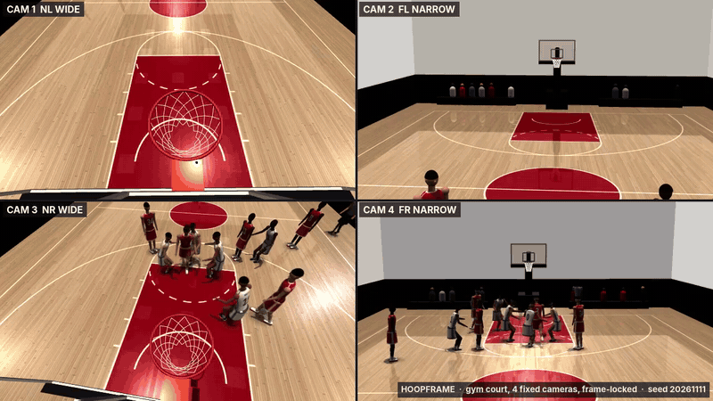
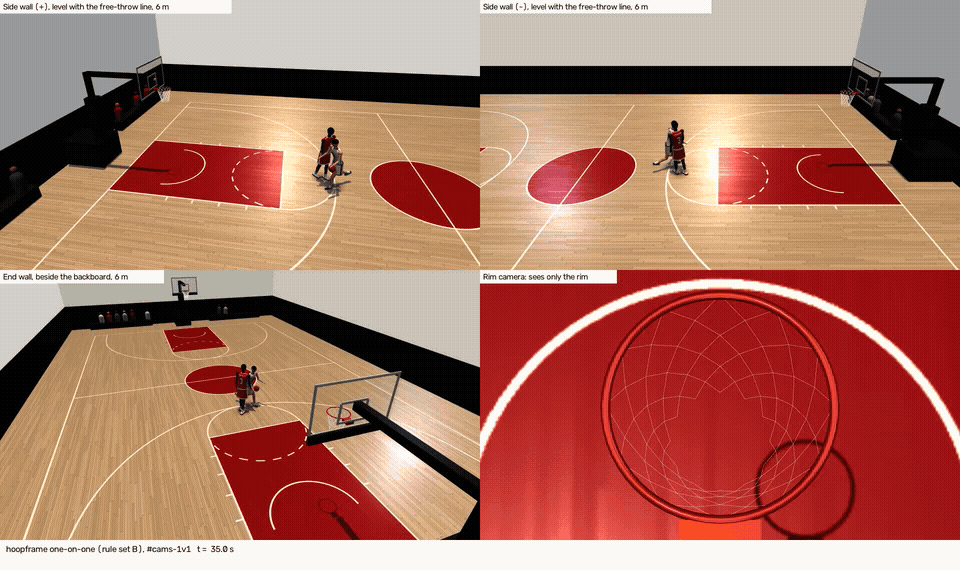

# Hoopframe

Synthetic 5-on-5 full-court basketball with two referees and four configurable cameras. Possession changes ends
after every score and defensive rebound, with transition runs up the floor. It produces ground truth for
multi-view player and referee tracking and shot attribution in two ways:

- **Live feed over MQTT**: ball, player, referee and camera state, plus game events, published every tick.
- **Synchronized recorder**: one MP4 per camera, frame-locked to per-frame ground truth, saved as a ZIP.

Optionally, two simulated radars on top of the backboards add range, angle and radial-speed detections, labelled
with their true sources (see [Radar sensors](#radar-sensors)).

[](docs/sample.mp4)

*12 seconds from the built-in recorder on the gym court (`#court-gym&cams-gym`): the gym's four fixed cameras
(NL wide, FL narrow, NR wide, FR narrow), 640 × 360 each, 30 fps, 180° shutter (1/60 s, 4 sub-frames per frame),
seed `20261111`, simulation time 84.5–96.5 s. HAR-3 scores at the +x end; MSA inbounds under that basket, runs
the floor in transition and MSA-0 scores at the −x end, with both referees switching ends.
Click for the [full-quality MP4](docs/sample.mp4).*

Everything is in `index.html`. Open it directly in **Chrome or Edge**: double-click it, or serve the folder with
`python3 -m http.server`. The hosted artifact preview blocks network connections and downloads, so MQTT
and recording only work from this file.

## Live feed (MQTT)

Browsers can only reach MQTT over WebSockets, so the broker needs a WebSocket listener. With Mosquitto:

```conf
# mosquitto.conf
listener 1883
listener 9001
protocol websockets
allow_anonymous true
```

```sh
mosquitto -c mosquitto.conf
```

In the page, open **Data out**, keep `ws://localhost:9001`, and press **Connect**. If the page is served over
HTTPS, the broker must be `wss://`, because browsers block `ws://` from secure pages.

| Topic | QoS | Payload |
| --- | --- | --- |
| `hoopframe/frame` | 0 | Full snapshot for one tick: the same object as a `groundtruth.jsonl` line |
| `hoopframe/ball` | 0 | `pos`, `vel` (null while held), `state` (`held`/`pass`/`free`), `holder`, `pass_to`, `shot_id` |
| `hoopframe/players` | 0 | All ten players |
| `hoopframe/player/<id>` | 0 | One player, e.g. `hoopframe/player/HAR-23` |
| `hoopframe/referees` | 0 | Both referees: `id`, `track`, `role` (`lead`/`trail`), position, velocity, keypoints |
| `hoopframe/camera/<1-4>` | 0 | Calibration `K`, `R`, `t` and, if enabled, 2D `annotations` |
| `hoopframe/radar/<1-2>` | 0 | With `#radar`, `#radar-imaging` or `#radar-commodity`: one radar's `detections` and labelled `truth` (see [Radar sensors](#radar-sensors)) |
| `hoopframe/events` | 1 | `shot`, `shot_result`, `pass`, `catch`, `rebound`, `inbound`, `recover`, `steal`, `possession`, `transition_start`, `transition_end`, `tipoff`, `recording_start`, `recording_stop` |
| `hoopframe/recorder` | 1 | Recording start/stop markers with `take` and frame counts |
| `hoopframe/status` | 1, retained | `online`, session, seed, roster, referees. A last-will message flips it to `online: false` |

Every message carries `session`, `frame`, `t` (simulation seconds) and `wall_ms`. While idle, frames are
published on the simulation clock at the chosen rate (`frame = floor(t * rate)`). While recording, they are
published once per captured video frame, and `frame` is the video frame index.

```python
# pip install paho-mqtt
import json, paho.mqtt.client as mqtt

def on_message(client, userdata, msg):
    m = json.loads(msg.payload)
    if msg.topic.endswith("/events") and m["type"] == "shot_result":
        print(m["shot_id"], m["shooter"], m["kind"], m["points"])
    elif msg.topic.endswith("/ball"):
        print(m["frame"], m["pos"], m["holder"])

c = mqtt.Client(mqtt.CallbackAPIVersion.VERSION2)
c.on_message = on_message
c.connect("localhost", 1883)
c.subscribe([("hoopframe/ball", 0), ("hoopframe/events", 1)])
c.loop_forever()
```

## Synchronized recorder

Tick the cameras, then pick the frame rate, bitrate, shutter and maximum length, and press **Start recording**.
Recording is **lockstep**. Each captured frame advances the game by exactly `1/fps` and renders every ticked
camera over that frame's exposure, at that camera's own output size, with the same post-processing as the
program view.
Capture runs as fast as the GPU allows, not in wall-clock time. Each camera's output size is locked while
recording. Position, aim and FOV can still change, and every change is captured in the per-frame calibration.

The ZIP (`hoopframe_<session>_takeNN.zip`) contains:

| File | Contents |
| --- | --- |
| `camN_<name>.mp4` | H.264 (VP9 or AV1 if H.264 is unavailable). Frame `k` has `pts = k / fps` |
| `groundtruth.jsonl` | Line `k` is the snapshot for video frame `k` in every camera |
| `events.jsonl` | Game events. `frame` is the video frame in which the event happened |
| `manifest.json` | fps, frame count, seed, cameras, files, roster, court and coordinate conventions |

Frame rates are divisors of the 240 Hz physics step (24/30/48/60), so `t` advances exactly `1/fps` per frame.

### Shutter and motion blur

The **Shutter** setting gives recordings real motion blur. A frame's exposure lasts `angle / 360 / fps`
seconds. The recorder renders one sub-frame per 1/240 s physics step across that exposure and averages them
in linear light, the way a sensor integrates light. Fast movement (the ball in flight, hands, feet) streaks
along its path, and anything still stays sharp.

| Shutter at 30 fps | Exposure | Sub-frames per frame | Render cost |
| --- | --- | --- | --- |
| Off (0°) | instant | 1 | 1× |
| 90° | 1/120 s | 2 | 2× |
| 180° (default, the film standard) | 1/60 s | 4 | 4× |
| 360° | 1/30 s | 8 | 8× |

Labels describe the **centre** of the exposure, and `t` is that instant. With an even sub-frame count, `t` is
the sample just before the exact centre, which `mean_t` gives (1/480 s later). Each ground-truth line also carries
an `exposure` block with the sample times and the ball's 3D position at every sub-frame. Each camera's ball
annotation adds `path_2d`, the ball's pixel position at every sub-frame, so a model can learn the streak's
extent, not only its centre. The program monitor and the MQTT feed outside recording stay sharp. With
fixed cameras there is no camera-motion blur. A camera that tracks or follows moves during the exposure,
and its blur is included.

### Ground-truth line

```jsonc
{
  "session": "20261111T152320-d7da", "seed": 20261111, "frame": 60, "t": 3.9583,
  "exposure": { "shutter_deg": 180, "duration_s": 0.016667, "samples": 4,
                "start_t": 3.9542, "end_t": 3.9667, "mean_t": 3.9604, "ball_path": [[x, y, z] /* one per sub-frame */] },
  "possession": "HAR", "phase": "play", "attack_dir": 1, "transition": { "from": "defensive_rebound", "t": 1.25, "team": "HAR" },
  "score": { "HAR": 4, "MSA": 2 },
  "ball": { "pos": [x, y, z], "vel": null, "state": "held", "holder": "HAR-23", "pass_to": null, "shot_id": null },
  "players": [{
    "id": "HAR-23", "track": 2, "team": "HAR", "number": 23, "height_m": 2.01,
    "pos": [x, jump_height, z], "vel": [vx, vy, vz], "yaw": 1.57, "speed": 3.1,
    "action": "none", "airborne": false, "has_ball": true,
    "keypoints": { "head_top": [x, y, z], "head": [], "neck": [], "shoulder_l": [] /* … 18 joints */ }
  }],
  "referees": [{ "id": "REF-1", "track": 10, "role": "trail", "height_m": 1.81, "pos": [x, 0, z], "vel": [vx, 0, vz],
                 "yaw": 0.4, "speed": 2.2, "keypoints": { /* same 18 joints */ } }],
  "cameras": [{
    "id": 1, "name": "Broadcast", "width": 1280, "height": 720, "fov_y": 32,
    "K": [[fx, 0, cx], [0, fy, cy], [0, 0, 1]], "R": [[]], "t": [],
    "position": [x, y, z], "quaternion": [x, y, z, w], "follow": null, "track_ball": true,
    "annotations": {
      "players": [{ "id": "HAR-23", "track": 2, "in_frame": true, "truncated": false,
                    "bbox": [x, y, w, h], "bbox_unclipped": [x, y, w, h], "depth_m": 14.2,
                    "occlusion": 0.25, "keypoints_2d": [[u, v, visibility] /* 18, in "keypoints" order */] }],
      "referees": [{ "id": "REF-1", "track": 10, /* same fields as players */ }],
      "ball": { "in_frame": true, "center": [u, v], "radius_px": 6.1, "bbox": [x, y, w, h], "depth_m": 15.0, "occluded": false,
                "path_2d": [[u, v] /* one per sub-frame, null if behind the camera */] }
    }
  }]
}
```

**Conventions**

- **World:** metres, right-handed. The origin is centre court at floor level. `+x` points toward the basket HAR
  attacks (rim centre at `x = 12.7264`, `y = 3.05`); MSA attacks the `-x` basket. `attack_dir` is `+1` or `-1`, the
  sign of the basket the team in possession attacks. `+y` is up, and CAM 1's sideline is `-z`. Player `yaw`
  is in radians, facing `(sin yaw, 0, cos yaw)`. The manifest's `court.rims` gives both rims.
- **Cameras:** pinhole, no distortion, OpenCV convention: `[u v 1]ᵀ ~ K (R·X + t)`. The pixel origin is the
  top-left corner, and the camera looks along `+z`. The recorded pixels have been checked against these
  annotations.
- **Keypoints:** `head_top, head, neck, shoulder_l/r, elbow_l/r, wrist_l/r, pelvis, hip_l/r, knee_l/r,
  ankle_l/r, toe_l/r`. 2D visibility codes: `0` = behind the camera, `1` = outside the image,
  `2` = inside the image. Self-occlusion is not tested per keypoint.
- **Occlusion:** the fraction of head, pelvis and both knees hidden from the camera by *other players' and
  referees' bodies*. The ball's `occluded` flag uses any player or referee body, including the holder's hands.
  The hoop, stanchion and crowd are not tested.
- **IDs:** players are `<team>-<number>` (`HAR-23`) with `track` 0–9; referees are `REF-1` and `REF-2` with
  `track` 10 and 11. Track numbers are stable for the whole session.

### Transitions and referees

A change of possession (a defensive rebound, a made basket, a steal, or a loose ball recovered by the other team) sends
play to the other end:

- **After a basket**, the nearest player of the team taking over steps out behind the end line and inbounds to a
  guard (`pass` with `purpose: "inbound"`).
- **After a defensive rebound**, the rebounder usually outlets to a guard on the wing (`purpose: "outlet"`), or
  brings it up themselves.
- The handler pushes the ball up the floor at about 5.6 m/s while teammates sprint to their spots at
  6.4–6.8 m/s, filling the lanes. Defenders sprint back to a spot between their man and the basket and pick
  them up as they come up the floor.
- If no defender is back, the handler attacks the rim. A teammate who has beaten their defender down the floor may get
  the ball ahead (`purpose: "ahead"`). Otherwise the offence sets up in the half court.

`transition_start` gives `team`, `from` (`made_basket`, `defensive_rebound`, `steal` or `recover`), `attack_dir`, `handler`
and `first_pass_to`. `transition_end` gives `result` (`set_offense`, `fast_break`, `shot` or `timeout`) and
`duration_s`. While a transition is running, every frame's `transition` field is set.

The two referees use two-person mechanics. REF-1 works the `-z` side of the court and REF-2 the `+z` side.
Facing the basket being attacked, the **trail** runs the sideline on the left, level with or behind the ball, no
deeper than the free-throw line extended. The **lead** stands on the end line beyond that basket, between the lane
and the sideline, closing toward the lane when the ball is on the far side. On a change of possession, the trail
runs ahead down their own sideline to become the new lead, and the lead becomes the new trail. Referees wear
black-and-white striped short-sleeved shirts, black trousers and black shoes. They are about 1.81 and 1.86 m tall,
and players and referees step around each other.

### Shot attribution

Each `shot` event carries a `shot_id`, `shooter`, `team`, `floor_pos`, release point, `distance`, `three`
and `contested`. The matching `shot_result` carries the same `shot_id`, plus `made`, `points` and
`kind` (`swish`, `bank`, `rim_in`, `miss` or `airball`), rim and board contact, and the running score.
While the ball is in the air, `ball.shot_id` in every frame links the trajectory to the shot.
`rebound` events reference the `shot_id` they followed.

```python
import json, cv2
gt = [json.loads(l) for l in open("groundtruth.jsonl")]
cap = cv2.VideoCapture("cam1_broadcast.mp4")
for k, g in enumerate(gt):
    ok, frame = cap.read()            # frame k ↔ gt[k]
    if not ok: break
    ann = g["cameras"][0]["annotations"]
    for p in ann["players"]:
        if p["in_frame"]:
            x, y, w, h = map(int, p["bbox"])
            cv2.rectangle(frame, (x, y), (x + w, y + h), (0, 255, 0), 2)
```

## One-on-one

[](docs/sample_1v1.mp4)

*20 seconds of `#court-gym&seed-5&game-1v1&rules-b&cams-1v1` from the built-in recorder (fast render, 0° shutter),
the four cameras composed 2 × 2: a make, the loser's check, a 5th-dribble turnover and another make.*

`#game-1v1` plays one-on-one at the +x basket: one player of each team and two officials, who work the half court
as in 5v5 at the attacked basket (the lead on the end line beyond it, the trail on the other sideline, level with or
behind the ball). The attacker starts each
possession at the top of the key (7.3 m from the rim), dribbles between spots inside the arc with the ball on the side
away from the defender, who guards 0.9-1.4 m off on the line to the basket, and shoots with the usual gather, release
and ball flight. A loose ball goes to the first player to reach it. Two rule sets:

- **Rule set A** (default): a make is worth 1 inside the arc and 2 outside; after a make it is the loser's
  ball, checked at the top; after a defensive rebound or a steal the new attacker dribbles the ball out past the arc;
  offensive rebounds are live.
- **Rule set B** (`&rules-b`): 2 inside the arc, 3 outside; every possession starts with a check behind the
  arc (the ball carried there); at most 4 dribbles: the attacker holds the ball, takes up to 4 dribbles and shoots, or
  (one possession in ten) takes a 5th, a turnover and a check for the other player; a swiped ball is a turnover and a
  check. An offensive rebound is live with a new dribble count.

Events, besides `shot`, `shot_result`, `rebound` and `steal`: `possession` (`how`: `check`, `clear`, `rebound`,
`steal`), `dribble` (`n`: the count in the possession) and `turnover` (`how`: `fifth_dribble`). The defender may take
the dribble (`#steals-<rate>`). With `#game-1v1` off, every seed plays the same 5v5 game as before.

**Camera layouts for one-on-one** (with `#court-gym`), from gym-mv3dt's 1v1 layout study:

- `#cams-1v1`: two cameras on the side walls level with the free-throw line, 6 m up; one on the end wall 3.5 m to one
  side of the basket (beside the backboard: from directly behind it the board hides the lane); and a rim camera.
- `#cams-1v1oh`: the same with the ceiling camera above the key (6.9 m) instead of the end wall.

The rim camera, over the top edge of the backboard, frames only the rim: it shows makes and misses, nothing else.

The demo above was recorded before the officials were added.

## Steals

A defender the ball passes within 1 m of gets one try at a pass (an `interception`), and the on-ball defender, within
1.25 m of a dribbling handler, may take the ball (a `strip`). The ball then flies to the defender's hands in 0.14 s,
and the other team attacks. Each steal emits `steal` (`player`, `team`, `from`: who lost it, `kind`) and `possession`
with `how: "steal"`.

`#steals-<rate>` in the URL scales the chance of each try. The default 1 gives about one steal every two to three
minutes for the two teams together. `#steals-0` turns steals off, and a seed then replays the game it gave before
steals existed; with steals on, the same seed gives a different game.

## Gym court and camera layout

Two URL options, combined with `&` (and a seed: `#seed-123&court-gym&cams-gym`):

- `#court-gym` replaces the NBA arena with a real gym: a 70.3 × 45.05 ft (21.4 × 13.7 m) court with a 12 ft lane and
  a 19.75 ft three-point arc that runs straight to the baseline, pale maple to the walls, a red lane, white walls over
  a dark padded band 2.5 m beyond the baselines and 2 m beyond the sidelines, a dark 7 m ceiling with LED panels, and
  benches with a few spectators along the end walls instead of stands.
- `#cams-gym` replaces the four default cameras with that gym's fixed cameras at their true places, all at
  1920 × 1080: two on each backboard support, a wide one viewing its own half (NL, NR) and a narrow one viewing the
  far half (FL on the right support, FR on the left). Each camera is placed relative
  to its backboard, so the layout is exact on the gym court. On the arena court the narrow cameras stand 26.4 m
  instead of 20.4 m from the far baseline, framing it as in the gym, and players there look about 23 % smaller.

The manifest's `court` block gives the court used (`name`, `length`, `width`, `lane_width`). **Reset this camera**
returns to the layout's position.

## Radar sensors

`#radar` or `#radar-imaging` in the URL (for example `#seed-123&court-gym&cams-gym&radar`) adds two 4D imaging
radars; `#radar-commodity` adds two single-chip 60 GHz radars instead. There is one on top of each backboard: centred,
8.4 cm in front of the glass and 4.05 m up, within 25 cm of the gym layout's wide cameras, looking straight down the
court and tilted down by the angle that detects the most players (see [Aim](#aim)): 9.5° for `imaging` on both
courts; 48.5° (arena) and 30° (gym) for `commodity`. They are off by default. They change nothing in the game: the
same seed gives the same game, event for event, with or without them.

A radar measures **range, azimuth, elevation and radial speed** (Doppler: the speed toward or away from it), not
3D velocity. Both radars look along the court, so they measure motion along it well and sideways motion hardly at
all; full velocity has to come from tracking positions over time.

| | `imaging` | `commodity` |
| --- | --- | --- |
| Kind | Cascaded 77 GHz 4D imaging radar, 12 transmit × 16 receive antennas | Single-chip 60 GHz mmWave, 3 transmit × 4 receive antennas |
| Range resolution / maximum | 7.5 cm / 60 m | 3.75 cm / 25 m |
| Field of view (azimuth, elevation) | ±60°, ±15° | ±60°, ±40° |
| Angular resolution (azimuth, elevation) | 1.5°, 3° | 15°, 30° |
| Radial speed resolution / unambiguous maximum | 0.05 m/s / ±20 m/s | 0.1 m/s / ±8 m/s |
| SNR of 1 m² at 10 m / detection threshold | 45 dB / 12 dB | 33 dB / 12 dB |
| False alarms per frame | 1 | 0.3 |
| Tilt down (arena, gym) | 9.5°, 9.5° | 48.5°, 30° |

The figures are typical of each class, not of a particular product. The model (phase 1: one detection per object,
as a radar's detection and clustering stage reports it), each radar frame:

- takes each player and referee at the middle of the torso (1.3 m × body scale) and the ball at its centre, with
  their true velocity. The ball's velocity is measured from its motion every physics step, so it is known while
  held and dribbled too;
- keeps objects inside the field of view and maximum range;
- computes the signal-to-noise ratio from the radar equation (falls as range⁴), the radar cross section (person
  0.5 m², ball 0.01 m²), a 3 dB loss at the edge of the field of view and up to 20 dB when other bodies block the
  line of sight (the fraction of torso, head and hips hidden);
- detects the object with a probability of 50 % at the threshold, rising steeply above it;
- adds noise of resolution / √(2 SNR) in each dimension and, for a person, the wander of the reflection over the
  body (5 cm in range, 8 cm across, 0.1 m/s from arms and legs);
- merges objects it cannot tell apart (within 0.5 m in range, 0.5 m/s in radial speed and, in both angles, one
  resolution cell or a body width of 0.5 m at their range, whichever is larger) into one power-weighted detection that
  lists every source. Bodies are not points: two people closer than a body width return one smeared reflection however
  fine the radar's angles. A held ball usually merges with its holder;
- folds radial speeds beyond the unambiguous maximum back into range (Doppler aliasing: fast passes on `commodity`);
- adds false alarms with `sources: []`.

Not modelled yet: clutter from the floor, walls, hoop and stanchions, multipath, several points per body (arm and
leg micro-Doppler), and the radar's own tracker.

One radar frame is taken with every ground-truth line, so its rate is the MQTT rate or the recording frame rate.
Its noise comes from a generator seeded by the seed, radar and frame, never the game's: the same seed and frame
give the same measurement, however often `snapshot()` is called.

Each `groundtruth.jsonl` line (and `hoopframe/radar/<id>`) gets a `radars` array; `manifest.json`, the `status`
message and `hoopframe.radars()` give each radar's placement, `tilt_deg` and sensor figures, with `R_world_from_radar` (its
columns are the radar's x, y and z axes in world coordinates).

```jsonc
// shape of one entry (values illustrative)
{ "id": 1, "name": "Board +x", "sensor": "imaging", "frame": 812, "position": [13.021, 4.05, 0],
  "detections": [   // what the radar reports, sorted by range
    { "range_m": 6.412, "azimuth_deg": -12.3, "elevation_deg": -2.8, "radial_speed_mps": -2.31, "snr_db": 45.1,
      "position": [6.9, 1.9, -1.4],          // world coordinates computed from range and angles
      "sources": ["HAR-23", "ball"] } ],     // true sources; [] for a false alarm
  "truth": [        // every player, referee and the ball, in or out of view
    { "id": "HAR-23", "kind": "player", "position": [...], "velocity": [...], "range_m": 6.38, "azimuth_deg": -12.9,
      "elevation_deg": -2.6, "radial_speed_mps": -2.27, "in_fov": true, "hidden": 0, "snr_db": 45.4, "detected": true } ] }
```

Radar axes: x right, y forward (along the boresight), z up. Azimuth is `atan2(x, y)`, positive to the right;
elevation is positive up; radial speed is positive moving away.

### Aim

Each preset's tilt was chosen to detect as many players as possible. Aim changes only which objects fall inside the
beam, not blocking or range, so each player's position and blocking were recorded every 0.2 s for 300 s of seeds 7
and 11 on both courts, and the expected share of players detected by at least one radar was computed for every tilt
from 0° to 60° in 0.25° steps. That calculation agrees with the simulation to within 0.1 point.

| Preset, court | Aimed at centre court (17.3° arena, 23.3° gym) | Best tilt (range within 0.1 point of it) | Used |
| --- | --- | --- | --- |
| imaging, arena | 97.1 % | 9.5° (7.5–12.5°): 97.6 % | 9.5° |
| imaging, gym | 97.0 % | 9.25° (2.75–18.25°): 99.7 % | 9.5° (99.7 %) |
| commodity, arena | 81.7 % | 48.5°: 88.1 % | 48.5° |
| commodity, gym | 98.6 % | 30.25° (24.75–38.5°): 98.7 % | 30° |

The two seeds agree to within 1.25° for `imaging` and 3° for `commodity`.

- `imaging`: at 9.5° the top of the beam reaches the far baseline, and players under the near basket (below the near
  radar's beam, within about 6 m of it) are covered by the far radar, whose 60 m range spans the court. Aimed at
  centre court, the gym radars tilted so far down that the lead referee on the far baseline was just above the beam
  (by under 1.5°) while behind the near radar. The players still missed at 9.5° (2.5 % on the arena court) are all
  blocked by other bodies for every radar that has them in view, so no aim can recover them.
- `commodity`: with 25 m range, each radar mostly covers its own half, and tilting steeply widens its sideways reach
  below it. On the arena court 12 % of player-frames are out of reach at any tilt: more than 60° to the side of the
  near radar and more than 25 m from the far one; the referees on the sidelines are detected under half the time.
  On the shorter gym court any tilt from 25° to 38° gives the same result. No single tilt suits both courts (46.25°
  costs the gym half a point), so the tilt depends on the court.

**Measured** with the simulation at the tilts used, 300 s of seed 7, both radars pooled, compared with the old
centre-court aim. Errors are of single-source detections against the true point; median / 90th percentile.

| Preset, court, aim | Players detected | Referees detected | Ball detected | Player horizontal error | Player height error | Merged detections |
| --- | --- | --- | --- | --- | --- | --- |
| imaging, arena, centre court | 97.0 % | 96.5 % | 37.3 % | 0.086 / 0.168 m | 0.068 / 0.177 m | 1.6 % |
| imaging, arena, 9.5° | 97.5 % | 97.3 % | 35.0 % | 0.086 / 0.169 m | 0.069 / 0.179 m | 2.6 % |
| imaging, gym, centre court | 97.4 % | 59.7 % | 53.6 % | 0.082 / 0.155 m | 0.059 / 0.148 m | 0.4 % |
| imaging, gym, 9.5° | 99.7 % | 99.6 % | 71.3 % | 0.082 / 0.156 m | 0.060 / 0.148 m | 1.4 % |
| commodity, arena, centre court | 81.7 % | 45.8 % | 38.2 % | 0.159 / 0.708 m | 0.162 / 1.263 m | 7.2 % |
| commodity, arena, 48.5° | 87.6 % | 45.4 % | 42.1 % | 0.132 / 0.456 m | 0.118 / 0.870 m | 5.7 % |
| commodity, gym, centre court | 98.8 % | 93.3 % | 50.8 % | 0.140 / 0.428 m | 0.135 / 0.700 m | 7.1 % |
| commodity, gym, 30° | 98.9 % | 92.5 % | 51.6 % | 0.140 / 0.429 m | 0.135 / 0.716 m | 7.2 % |

"Detected" counts an object detected by at least one radar, merged or not. The centre-court rows were measured
before objects closer than a body width were merged; that rule raises `imaging`'s merged detections (from 2.3 % to
2.6 % on the arena court and 0.8 % to 1.4 % on the gym court at 9.5°) and changes nothing else in the table. Range error is about 3.5 cm and radial
speed error about 0.07 m/s for people with both presets (the body wander dominates). What this shows:

- `imaging` places people within about 10 cm wherever it sees them; horizontal error grows only from 8 cm at 5–10 m
  to 10 cm at 25–35 m.
- `commodity` gives range and radial speed as well, but its coarse angles put people about 0.5 m (horizontally) and
  0.9–1.0 m (in height) off at 20–25 m; height is barely measured. It sees the ball only within about 10 m, and fast
  passes alias.
- `imaging` detects the ball out to about 20 m (60–70 % of the time at 15–20 m), but held, the ball usually merges
  with its holder. Its 9.5° tilt costs the arena court 2 points of ball detection and gains the gym court 18.

## Commentary

The **Commentary** tab calls the game live. It does this from tracker-style data only, as a test of play-by-play
built on a court tracker instead of on video. Every 1/30 s of game time it gets what a multi-camera player
tracker and a ball tracker would report: each player's team, number, court position and velocity, plus the ball's
3D position. It never reads the simulator's ball state, holder, player actions or event log.

From that it detects passes, shots, makes and misses, rebounds, inbounds, steals and drives. Each shot gets its
spot, 2 or 3, the nearest defender's distance at the release (the NBA's 0-2 / 2-4 / 4-6 / 6+ ft bands), and
whether it was catch-and-shoot or pull-up (from dribbles seen in the ball's height). It also flags transition
and assists. Each event becomes a line spoken by one voice:

- A shot gets a short call at the release ("Mesa 42 pulls up for three..."). The result line describes it:
  "Bang! Pull-up three from the top of the key, right over Harbor 3. Harbor 8, Mesa 5."
- The colour goes in the result line, so calls during the play stay short. The opening words fit the shot ("From
  way downtown... bang!" for a deep three, "Oh, what a shot!" over a tight contest). The narrator also keeps
  track of its own calls to spot first baskets, ties, lead changes, runs of 6 or more unanswered points, the
  basket that ends a run, and a player's third straight make. The score is said when one of those happens, and
  otherwise every third basket. Phrases vary and the same one isn't picked twice running.
- Results and steals come first, then shot calls and rebounds. Drives, passes and inbounds are said only when
  the voice is free, and a shot cuts them off. A line that waits too long is dropped. A miss and its rebound are
  said together.
- **Speak aloud** uses the browser's speech synthesis. It works at 1× speed, unpaused and not recording;
  otherwise lines are timed at 3 words per second and shown as captions on the program monitor.

Each line shows its **glass-to-voice** time: from the moment on the court to the first spoken word. That time
includes the settings under **Latency**: the tracker's identity delay (1 s by default), capture (camera,
network, detector), and an optional rephrasing step for a language model. It also includes the measured speech
start (assumed 0.3 s until a line has been spoken aloud). **Tracker noise** adds Gaussian position noise, with
optional smoothing.

**Identities** makes the names realistic. hoopframe's identities are always right, but a real court tracker's aren't,
so by default each player's identity gets a probability and is wrong as often as gym-mv3dt's court tracker was at that
probability on its held-out minute (each identity holds for 2-8 s; a wrong one is another number on the same team).
The commentator says a name only at probability 0.8 or more. Below that, a shot call, rebound, steal or drive names the
team instead ("Harbor pulls up...") or, if you choose, isn't said; a pass to an uncertain player isn't said, and a
result is called without an uncertain defender's or passer's name. Players are followed by track, so a wrong name
doesn't break the play. The other choices are the tracker's busier tuning minutes and "Always right".

The **Scorecard** compares the detected events with hoopframe's own as the game runs, and counts the names said and how
many were wrong. On seed 2, over 10
minutes of game with no noise and identities always right:

| Event | Found | Correct |
| --- | --- | --- |
| Shot | 55/55, 0 false | shooter 55/55, 2 or 3 55/55, contested 54/55 |
| Make or miss | 55/55 | 55/55; final score exact |
| Pass | 111/111, 1 false | passer and receiver 111/111 |
| Rebound | 22/23, 1 false | rebounder 19/22 |
| Inbound | 32/32 | 32/32 |
| Steal | none in the game | 3 false |

Median glass-to-voice with the default 1 s identity delay was 1.7 s for shot calls, 2.5 s for results (which
wait for the shot call to finish) and 1.9 s for rebounds. With the identity delay at 0, each is 1 s less. Most
wrong rebounders and false steals come from players overlapping in the simulation: at the moment of the
rebound, the wrong player can be closer to the ball.

`window.hoopframe.commentary()` returns the detected events, the lines with their timing, and the scorecard.
`window.hoopframe.commentarySettings({ posNoise: 0.2, smooth: 9, idModel: 'off' })` changes the settings for headless
runs (`idModel`: `heldout`, `tuning` or `off`; `minProb`; `unsure`: `team` or `skip`). With the default identities on
seed 2, 5 of 237 names said were wrong (2.1 %), 8 lines named the team instead, and the events found were unchanged.
The same detector in Python, for recorded takes and eventually the real tracker, is `tools/play_events.py` and
`tools/narrate.py` in [gym-mv3dt](https://github.com/bauer-san/gym-mv3dt) (branch `claude/youthful-volta-5bfn6r` for now).

## Reproducibility

The game logic runs on a seeded generator. The same seed gives the same game, event for event, at any
simulation time, independent of frame rate or recording. Set the seed in **Data out → Reproducibility**,
or open the page with `#seed-123` in the URL. Pressing **Shoot now** changes the game from that point on.
Running gait is driven by the game clock too, so body poses replay exactly.

Cosmetic detail (floor planks, crowd, ball and jersey textures) uses its own fixed seed, so every page load
looks the same. Long recordings can therefore be rendered in separate pieces and joined. Start each piece
with `hoopframe.advanceTo(start - 0.5)`, then `hoopframe.advanceTo(start, true)`, which runs the last half
second with animation. Poses at the seam then match an unbroken run to within a fraction of a millimetre.

## Limitations

- WebCodecs and the MP4 muxer need a current Chromium-based browser. The ZIP is built in memory: at 8 Mbps,
  four 720p cameras for 60 s come to roughly 250 MB of video, plus about 30 KB of ground truth per frame.
- The images are synthetic. Players are procedurally animated, not motion-captured. Motion blur is
  rendered (see [Shutter and motion blur](#shutter-and-motion-blur)), but there is no lens distortion,
  rolling shutter or sensor noise, so expect a domain gap against real broadcast footage. The per-frame
  calibration and labels let you add those effects in post-processing.
- `window.hoopframe.advance(s)`, `advanceTo(t)`, `pose()`, `referees()`, `radars()`, `snapshot()`, `events()`, `commentary()` and `profile()`
  are test hooks for fast-forwarding, inspecting and timing the simulation. `snapshot()` returns the current
  ground-truth line. `events()` returns the events since its previous call; the first call starts the log.
  They do not render or record.
- There are no fouls, free throws, out-of-bounds turnovers, shot clock or periods. Play runs continuously.

## Licence

Copyright 2026 Ethos Engineering LLC. The code is licensed under the Apache License 2.0 ([LICENSE](LICENSE)); each code
file carries SPDX tags. Third-party components keep their own licences: Three.js, mqtt.js and mp4-muxer load from
jsDelivr at runtime and are MIT licensed by their authors.
